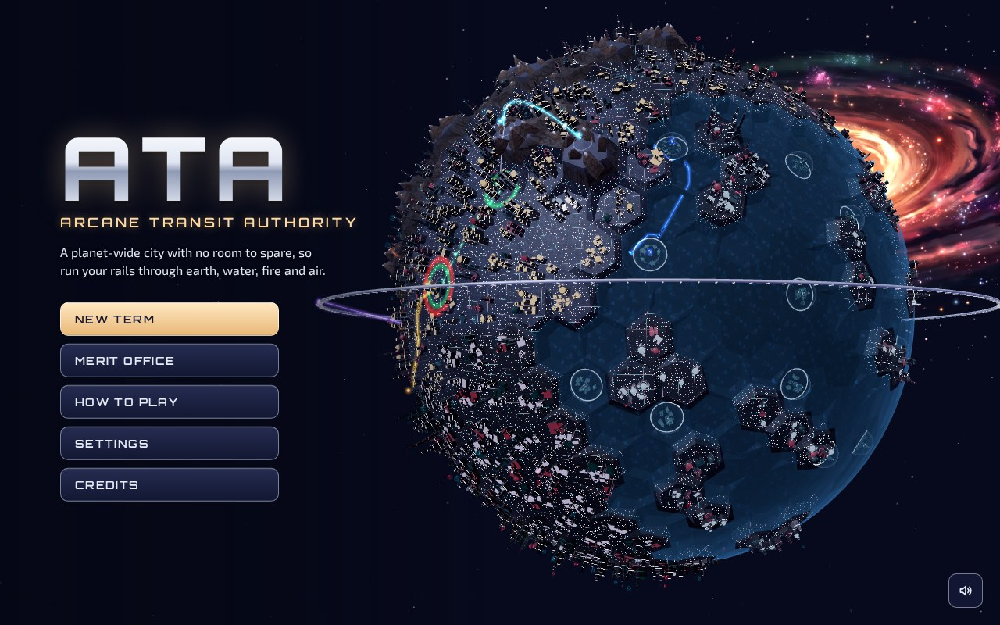
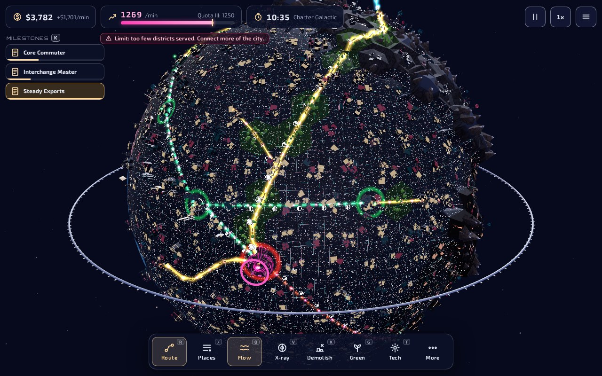
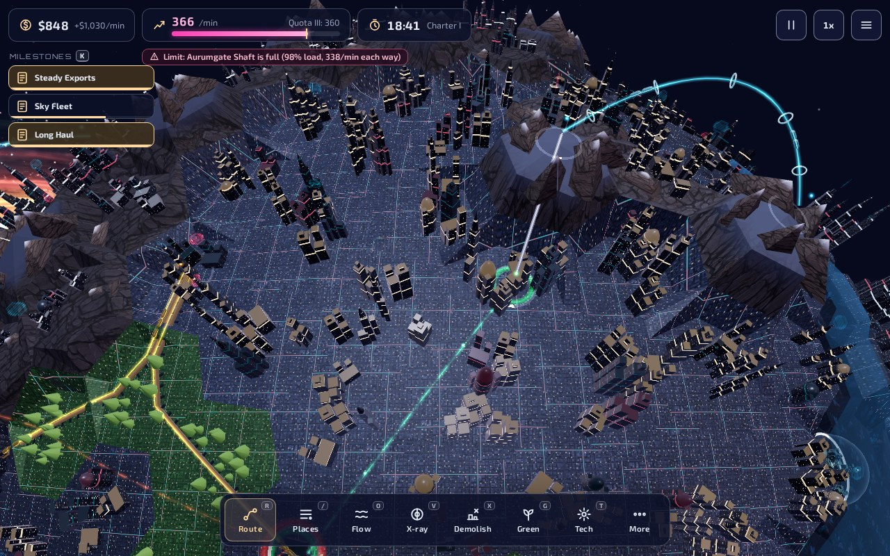
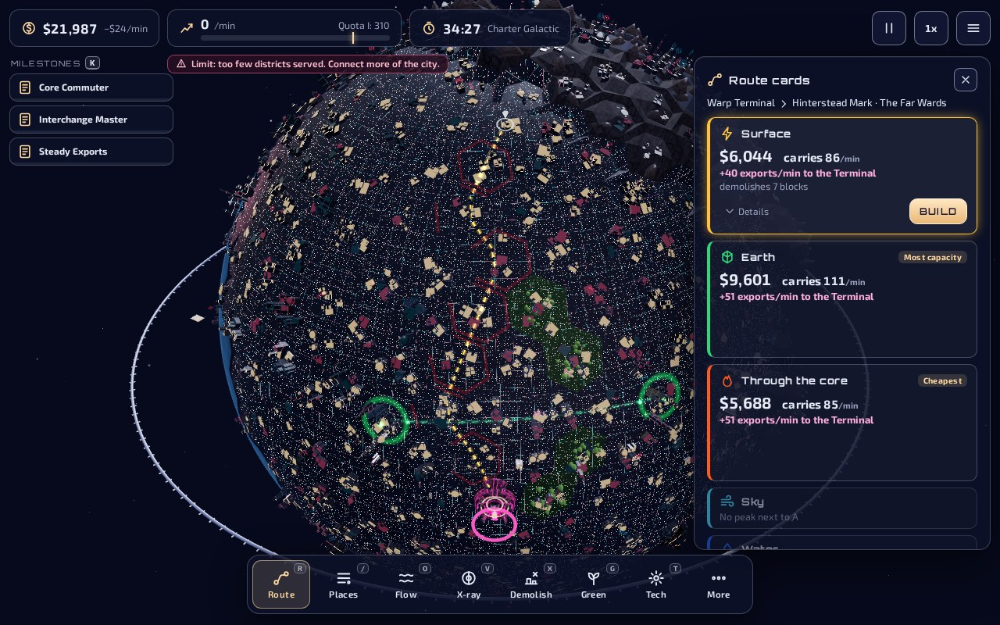
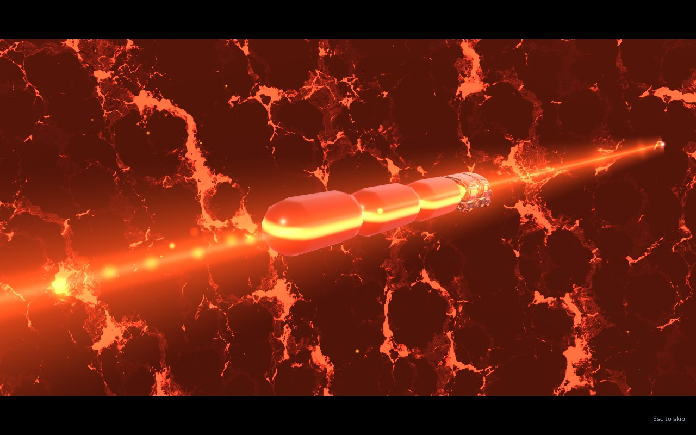
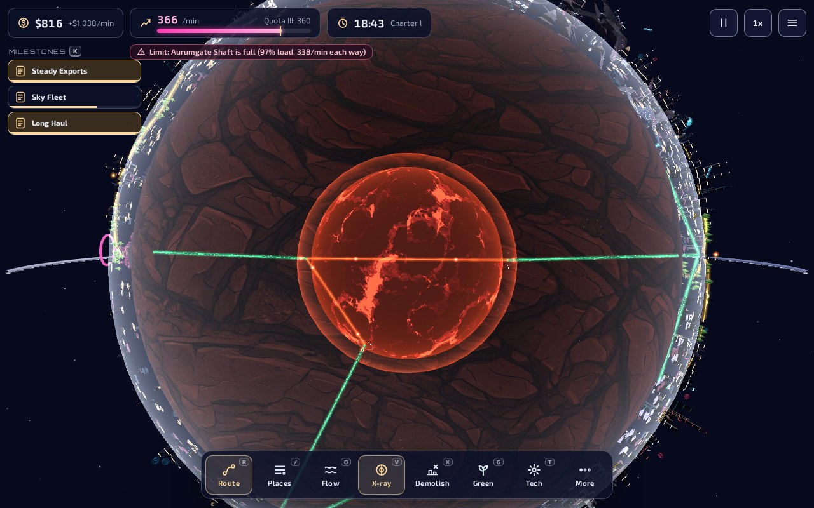
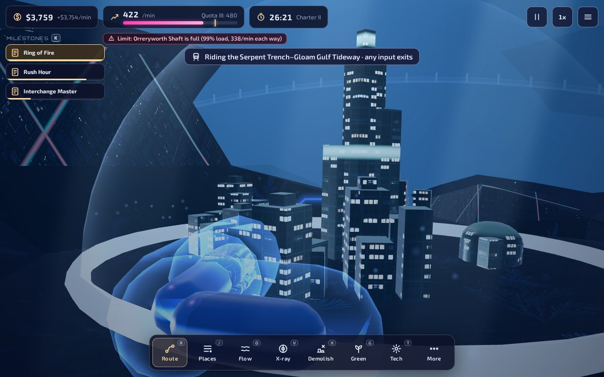
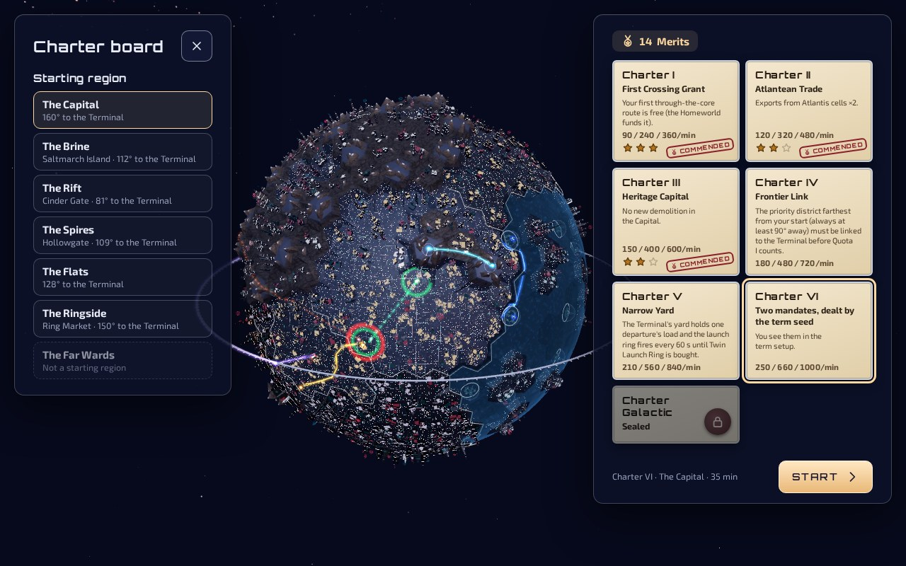

# Arcane Transit Authority

*A planet-wide city with no room to spare, so run your rails through earth, water, fire and air.*

You're the Chief Engineer of the Arcane Transit Authority on Oikumene, a planet covered pole to pole in one glittering neon city. There's no room left for a single new rail, so you go over it, under it and straight through it: pick two places, compare the route cards, and watch a glowing ley-rail draw itself across the rooftops, between mountain peaks, along the sea floor, through the rock, through the molten core or around the orbital ring. Every export you move rides a deep space train to the Homeworld at the heart of the galaxy.

**[▶ Play Arcane Transit Authority](https://arcanetransitauthority.synapticnoise.com/)** in your browser. No install. Made for a computer, with keyboard and mouse.

## The planet and its trains

Seven elemental trains, one colour each, each riding its own ley-rail:

| | |
|---|---|
|  |  |
| **The whole planet,** your network glowing across it, underground lines traced on the surface. | **Up close,** a neon city: Surface maglevs, Sky arcs between peaks, stations climbing the slopes. |
|  |  |
| **Route cards:** every pair of places deals you the routes that could link them, each with its cost, what it carries and what it adds to exports. | **Through the core:** Earth trains dig down, Fire trains swim the lava, and you come out on the far side of the world. |
|  |  |
| **X-ray** shows the bores, shafts and the line through the core. | **Atlantis:** Water trains glide along the sea floor between glass domes. |

Play a **term** under one of six Homeworld Charters, each with its own mandate and three Quotas to meet before the Audit. Commend a Charter to unlock the next one and a new starting region, spend Merits between terms on milestone cards, perks and liveries, and commend all six for the finale.

## How to play

- **Build a route:** click a place, click another, then pick a route card (click it, or Enter). Cards show the cost, how many riders a minute the line carries, and how many exports a minute it adds.
- **Look around:** drag to spin the globe (or arrow keys / WASD), mouse wheel to zoom (+ / −), right-drag or Q / E to tilt.
- **Tools:** Route R · Places / · Flow O · X-ray V · Demolish X · Green G · Tech T · milestones K · layers Shift+1 to Shift+7.
- **Lines:** select a line, then + / − adds or removes a train, and C rides it.
- **Disasters:** Brace (1) or Reroute (2) when a warning shows, then repair.
- **Time:** Space pauses, F cycles 1x / 2x / 4x. Ctrl+Z (or U) undoes your last build for 10 seconds.
- **Pause and save:** Esc or P. Save to a slot or load one from the pause menu; Continue and Load are on the title too. **Mute:** M.
- The Throughput meter at the top says what's limiting your exports; click the Limit chip under it to see it.
- Found a bug? Pause and pick "Report a bug", or press Ctrl+Shift+F (you'll need a GitHub account).

The first New Term is a tutorial with Juno, your dispatcher. A term ends when you meet Quota III (or the Audit deadline passes, or you go bankrupt). Merits, unlocks and settings are saved in your browser, and every term in progress has its own autosave.

You can install it from your browser's menu to play in its own window, even offline.

## How it was made

Arcane Transit Authority was made by [Claude Code](https://claude.com/claude-code) with [gamegen](https://github.com/zeveck/gamegen), from this request:

> /gamegen --plan-only --share-design --mockups 10 so for instance, one of the reasons that you could want a mega city is cuz you have a whole planet that's a mega City and the whole planet's covered in the city and then when you're like. Oh how we going to get trains around the planet. You have this problem because when you go to build trains through the established mega City you have to clear a buildings which is really expensive. But you have other options if you had magic trains. So if you had like an Earth train that could just tunnel through Earth, you could go right through the core of the planet or at least through some mountains, but that's not actually well. The car is too hot so you also need fire trains so that the Earth train gets to the core and gets a fire train and then you get an Earth train on the other side and then you can have SkyTrain so you can go from like the top of Mount Everest to the top of katahdin or something. And that means you need water trains that go under the ocean and you can have like Atlantis and other underwater stuff. So you have these trains of different types. And now you have this cool City on the whole surface that robotnik would love. But you have this train Network snaking through the city and through the air and underground and through the core. And you're trying to manage this train business. So it's kind of like Sim train, but kind of you know you're just building trains and it's fun and it looks cool. But they're maybe 3D wormy Futurama tube, kind of trains and maybe the game may be called Eecumenopolitical Engineer, but don't require it. You're managing the train system to maximize the throughput/efficiency of the Homeworld, with is at the center of the Galaxy. It's part railroad sim, part a sort of inverted rebuilding of an ecumenopolis because you CAN use money to buy and demolish buildings and lines of buildings so play trains, and add parks, trees, track-side attractions, etc. Overall victory is a job well done. There could be random disasters you have to deal with.

gamegen asked whether "3D train routes" meant a 3D game, and the answer came back as a question:

> Do you think this game can work as 2D with a 3D look? Or is it intrinsically a 3D idea? Making 3D train routes seems a little tricky, but cool if doable. Otoh, capturing the ideas may be tricky in 2D. Not sure. Thoughts?

Then stations, interchanges, a tech tree and roguelike unlocks:

> So you build stations? I guess also interchanges, like where earth has to hand off to fire and back to go through the core? There should probably be some sort of tech tree with upgrades per type of train. And maybe train upgrades for hitting certain miltestones, like having so many miles of track, or so many trains of each type, etc. these milestones are kinda bonuses, and you could have a few, and they could be random so each game has a slightly different nudge. You could open them up rougelike style, buying them between games.

Then space and deep space trains:

> There are probably also space trains that go around the world, and maybe deep space trains the warp away and back, but you don't actually handle their other sides, except as story snips or something.

And the choice:

> You've convinced me, 3d. I have a Meshy Key.

The design was reviewed, shared as a page with mock pictures, and reshaped over a long conversation: the trains became elemental machines with one clear colour each and a cyberpunk lean, the name settled on Arcane Transit Authority, the game stayed on one planet, the tubes became ley-rails, and the tagline was found:

> All the pictures in th linked artifact are oddly distorted when I view it in my phone. Also, the trains are kinda boring. They should better reflect their elements and the fantasy nature and everything should lean a bit cyberpunk.
>
> Do we think this is actually a good name?
>
> When I made the original prompt I said I wasn't wed to the name. So if it's not a good name we should try something else. But I don't love anybody else. You proposed other ideas
>
> Ecumenical Engineer?
>
> The new graphics look a lot better, but the trains should not literally look like monsters or dragons. We want to lean into them being magical conveyances but without acting like they are creatures or something. I feel like you are close. I do kind of like Arcane Transit Authority except that it also is pretty long, But does shorten it nicely too ATA. Anyways with the graphic adjusted so we aren't really talking about wryms I'm guessing it's going to shift the naming possibilities so let me know next thoughts.
>
> Why are they six planets?
>
> I thought my prompt was really around there being a single ecumenical planet and specifically even said that when you went teleporting off into deep space you didn't see where it went. So how did we end up with six planets?
>
> The train shouldn't have spikes down. Its back like a dragon either probably.
>
> Giving them each a clear is a good idea right now. You mostly have that, but two yellowish ones read the same. It would be nice to be able to easily tell the element by looking at the train and it's color.
>
> Those trains are much better looking now, but why does the magenta one have a weird halo-ish thing?
>
> Okay, let's go with Arcane Transit authority and let me know when the new version of the plan is all set for me to look at
>
> I didn't necessarily mean for them to all run in tubes. That only kind of makes sense because if you already have tubes you don't need to be a water train or a fire train or something because you already kind of made the tube. I pictured the trains going straight through these environments. Also, the ice trains iciness is just breaching the tube entirely which doesn't look right if we are going to have to. But if we don't have tubes then we don't have tracks unless we have something that's more literally a train track. Thoughts?
>
> I like the ley rails proposal.
>
> The shared proposal should be entirely updated to reflect the game as we've polished it because I haven't shared it with anybody yet and when I do I want it to be accurate.
>
> It's weird for the document to call out " no tubes". So we should do a polish past that. Make sure it just reads as its own self-contained design document and doesn't presume that readers have seen prior versions.
>
> "A whole planet is one city. Your magical trains go over it, under it, and straight through it." Reads a little awkward. I wonder if we wanna say this slightly differently. Also, I feel like we should focus on elemental / advanced trains over actually calling them magical. Albeit, we have Arcane in the title. Hem
>
> I think like #2, except you can build through the the city at cost
>
> Nah, that's was less good
>
> I lean #1. Let's try some variations
>
> You sure spoken for every time
>
> I wonder if we can get a rhyme in there. Spare air or more core hrm
>
> That's aligned oddly. I'd thought more like ""A planet-wide city with no room to spare, so run your rails through the earth, the sea, the, the core, and the air." But I don't like that either
>
> Let's use #1
>
> Let me know when the plan is solid.
>
> I meant the share doc, but good to polish the plan then the doc.

Then the plan went on the plans page, and the build began:

> /gamegen --plans

> /gamegen --continue --budget 50 --platform desktop --3d --publish --no-confirm --art-sheet --feedback on

And during the build, save slots:

> We'll definitely want save/load with slots and not just one global save

gamegen wrote a brief and a design, had player, builder and art-director agents review it, made the art, models, music and sound, built the game in plain JavaScript and three.js, and play-tested it: a simulation helper built a deterministic sim with a solver that wins every Charter, a browser builder made the 3D game on top of it, and fresh reviewers played it, hunted bugs and polished every screen over several rounds. The plugins:

- [imagegen2](https://github.com/zeveck/imagegen2): the concept art for every train and station, the style anchor and the portraits of Juno, Auditor Thrumm and the Warp Conductor.
- [nanogen](https://github.com/zeveck/nanogen): the key art scenes, the galactic-core backdrop, the finale picture and the textures (windows, streets, rock, sea floor, magma, lava).
- [meshgen](https://github.com/zeveck/meshgen): the 15 3D models, seven train lead cars and eight stations and landmarks, from the concept art.
- [audiogen](https://github.com/zeveck/audiogen): six music tracks, 42 sound effects and two ambience beds.

The design, its reviews and the mock pictures are in [`design/`](design/): start with [`design/GAME_DESIGN.md`](design/GAME_DESIGN.md).

## Replaying the tests

The simulation is deterministic and runs in Node as well as the browser. Every Charter has a recorded winning term in `design/solutions/charter-<n>.json`:

    node --test tools/test/*.test.mjs      # the sim's tests
    node tools/solve.mjs --verify          # replay all seven recorded terms in Node and check their hashes
    node tools/solve.mjs --sweep           # play every Charter from every region on two seeds
    node tools/starthashes.mjs --check     # every term starts the same in any engine
    node tools/oikumene.mjs                # build and check the planet's map
    node tools/contrast.mjs                # palette and contrast rules

To replay the recorded terms in a browser with real mouse and keyboard input (needs [playwright-cli](https://github.com/microsoft/playwright-cli)), serve the game on port 8130 and run:

    node tools/replay.mjs --runs 2

## Playing locally

Arcane Transit Authority is a plain web page with no build step. Serve the `game` folder with any static web server, for example:

    cd game
    python3 -m http.server 8000

then open http://localhost:8000.

## Credits

- The idea: Rich Conlan.
- Fonts: [Orbitron](https://fonts.google.com/specimen/Orbitron) (modified as "ATA Display") and [Exo 2](https://fonts.google.com/specimen/Exo+2), under the SIL Open Font License (`game/fonts/`).
- [three.js](https://threejs.org/) (MIT), bundled in `game/vendor/`.
- [gh-feedback](https://github.com/zeveck/gh-feedback) for "Report a bug".
